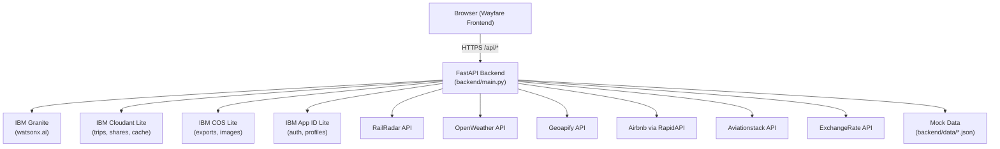

# Wayfare – AI Travel Planner

> **Powered by IBM Granite (watsonx.ai) · IBM Cloudant · IBM COS · IBM App ID · IBM Code Engine**

Wayfare turns a single sentence into a complete day-by-day travel itinerary. It supports domestic India trips and international journeys, with real-time transport options, weather, maps, price comparison, smart replan after disruptions, and collaborative trip sharing.

---

## Architecture



**Key design rules:**
- The browser **only calls our own `/api` routes** — no third-party API calls from the browser.
- All secrets stay on the backend, read from environment variables.
- Every provider has a live + mock implementation behind the same interface. Switch via `USE_LIVE_*` flags.
- The whole app runs with **all `USE_LIVE_*=false`**.
- Cloudant and COS have **in-memory / local file fallbacks** for development (same interface).

---

## Project structure

```
wayfare/
  backend/
    main.py              FastAPI app, all API routes
    config.py            Settings loaded from .env
    agent/               Granite planner, replanner, tool schemas, prompts
    services/            One module per provider (rail, weather, places, …)
    data/                Mock JSON (INR prices, Indian cities)
    models/              Pydantic schemas (trip, providers, chat, share)
    db/                  Cloudant, COS, App ID helpers with dev fallbacks
  frontend/
    index.html           Landing page
    planner.html         Chat + itinerary + map
    trip.html            Trip dashboard
    compare.html         Price comparison
    shared.html          Collaborative shared view
    css/                 tokens.css, base.css, components.css
    js/                  api.js, chat.js, itinerary.js, map.js, compare.js, replan.js, share.js
  tests/
    test_services.py     Mock service + fallback tests
    test_replan.py       Smart replan logic tests
    test_api.py          API endpoint + role enforcement tests
  requirements.txt
  .env.example
  pytest.ini
```

---

## Quick start (all mock, no keys needed)

```bash
# 1. Clone / unzip
cd wayfare

# 2. Create .env
cp .env.example .env
# All USE_LIVE_* flags default to false — no changes needed for mock mode

# 3. Install dependencies
pip install -r requirements.txt

# 4. Start backend
uvicorn backend.main:app --reload
# → http://localhost:8000

# 5. Start frontend
python -m http.server 5500 --directory frontend
# → http://localhost:5500

# 6. Run tests
pytest
```

---

## IBM Cloud Lite setup

### Step 1 – IBM watsonx.ai (IBM Granite)

1. Go to [cloud.ibm.com](https://cloud.ibm.com) → Create an account (free).
2. Create a **Watson Studio** instance (Lite plan).
3. Create a **watsonx.ai** project. Copy the **Project ID**.
4. Go to **Manage → Access (IAM)** → Create an **API key**. Copy it.
5. Set in `.env`:
   ```
   WATSONX_URL=https://us-south.ml.cloud.ibm.com
   WATSONX_API_KEY=<your_api_key>
   WATSONX_PROJECT_ID=<your_project_id>
   GRANITE_MODEL_ID=ibm/granite-3-8b-instruct
   ```

### Step 2 – IBM Cloudant Lite

1. Catalog → **Cloudant** → Create (Lite plan, free).
2. After creation → **Service credentials** → Create → Copy the `url` and `apikey`.
3. In the Cloudant dashboard, create these databases: `trips`, `shares`, `collab`.
4. Set in `.env`:
   ```
   CLOUDANT_URL=https://your-instance.cloudantnosqldb.appdomain.cloud
   CLOUDANT_API_KEY=<your_cloudant_api_key>
   ```

### Step 3 – IBM Cloud Object Storage Lite

1. Catalog → **Object Storage** → Create (Lite plan).
2. Create a bucket named `wayfare-exports` (region: `us-south`).
3. **Service credentials** → Create (with HMAC) → Copy the `cos_hmac_keys.access_key_id`, or use IAM API key.
4. Set in `.env`:
   ```
   COS_API_KEY=<your_cos_iam_api_key>
   COS_INSTANCE_CRN=crn:v1:bluemix:public:cloud-object-storage:global:a/...
   COS_ENDPOINT=https://s3.us-south.cloud-object-storage.appdomain.cloud
   COS_BUCKET=wayfare-exports
   ```

### Step 4 – IBM App ID Lite

1. Catalog → **App ID** → Create (Lite plan).
2. **Manage Authentication** → Set redirect URLs: `http://localhost:8000/api/auth/callback`.
3. **Applications** → Add application → Copy `clientId`, `secret`, `tenantId`, `region`.
4. Set in `.env`:
   ```
   APPID_TENANT_ID=<tenant_id>
   APPID_CLIENT_ID=<client_id>
   APPID_SECRET=<secret>
   APPID_REGION=us-south
   ```

### Step 5 – IBM Code Engine (deploy)

```bash
# Install IBM Cloud CLI
# ibmcloud login --apikey YOUR_KEY --region us-south

# Create Code Engine project
ibmcloud ce project create --name wayfare

# Build and push container
docker build -t wayfare-backend .
ibmcloud cr login
docker tag wayfare-backend us.icr.io/<namespace>/wayfare-backend:latest
docker push us.icr.io/<namespace>/wayfare-backend:latest

# Deploy
ibmcloud ce application create \
  --name wayfare-api \
  --image us.icr.io/<namespace>/wayfare-backend:latest \
  --port 8000 \
  --min-scale 0 --max-scale 3 \
  --env WATSONX_API_KEY=... \
  --env WATSONX_PROJECT_ID=... \
  --env CLOUDANT_URL=... \
  --env CLOUDANT_API_KEY=... \
  # ... all other env vars
```

---

## Switching from mock to live providers

Edit `.env` and set the flag to `true`, then set the corresponding API key:

| Provider     | Flag                   | Key variable            |
|--------------|------------------------|-------------------------|
| RailRadar    | `USE_LIVE_RAILRADAR`   | `RAILRADAR_TOKEN`       |
| OpenWeather  | `USE_LIVE_WEATHER`     | `OPENWEATHER_API_KEY`   |
| Geoapify     | `USE_LIVE_GEOAPIFY`    | `GEOAPIFY_API_KEY`      |
| ExchangeRate | `USE_LIVE_FX`          | `EXCHANGE_RATE_API_KEY` |
| Aviationstack| `USE_LIVE_AVIATIONSTACK`| `AVIATIONSTACK_API_KEY`|
| Airbnb stays | `USE_LIVE_AIRBNB`      | `RAPIDAPI_KEY`          |

Each provider automatically falls back to mock data if the live call fails, times out, or returns an unexpected shape. The UI labels mock results **"Sample data"**.

> **Security reminder:** Rotate any API key that was ever shared in a document or committed to source control.

---

## Demo script

1. **Open** `http://localhost:5500/planner.html`
2. **Plan a trip:** type `"Plan a 4-day trip from Delhi to Jaipur for 2 adults, budget ₹15000"`
3. **Review** the itinerary: transport options with Cheapest/Fastest/Best Value badges, weather, map markers.
4. **Compare prices:** open `compare.html`, enter Delhi → Mumbai → see Granite's best-value reason.
5. **Share the trip:** click **Share trip** → copy the Viewer link → open in an incognito window.
6. **Add a comment** from the shared view.
7. **Simulate a disruption:** click **Simulate disruption** → see the Before vs After replan modal.
8. **Approve the replan** with one tap → itinerary updates.
9. **International replan:** plan Delhi → London → simulate flight cancellation → see alternate flight with visa and layover notes.

---

## Running tests

```bash
pytest                  # all tests
pytest tests/test_replan.py -v    # replan logic only
pytest tests/test_api.py -v       # API + role checks
```

All 29 tests pass with all `USE_LIVE_*=false`.

---

## Notes

- `FakeGraniteClient` is **only used in automated tests**, never in the running application.
- In-memory Cloudant fallback and local COS fallback are **development only**. Production uses the real IBM Cloudant and COS endpoints.
- The frontend uses **ES modules** — run it via a server (`http.server 5500`), not by opening the file directly.
